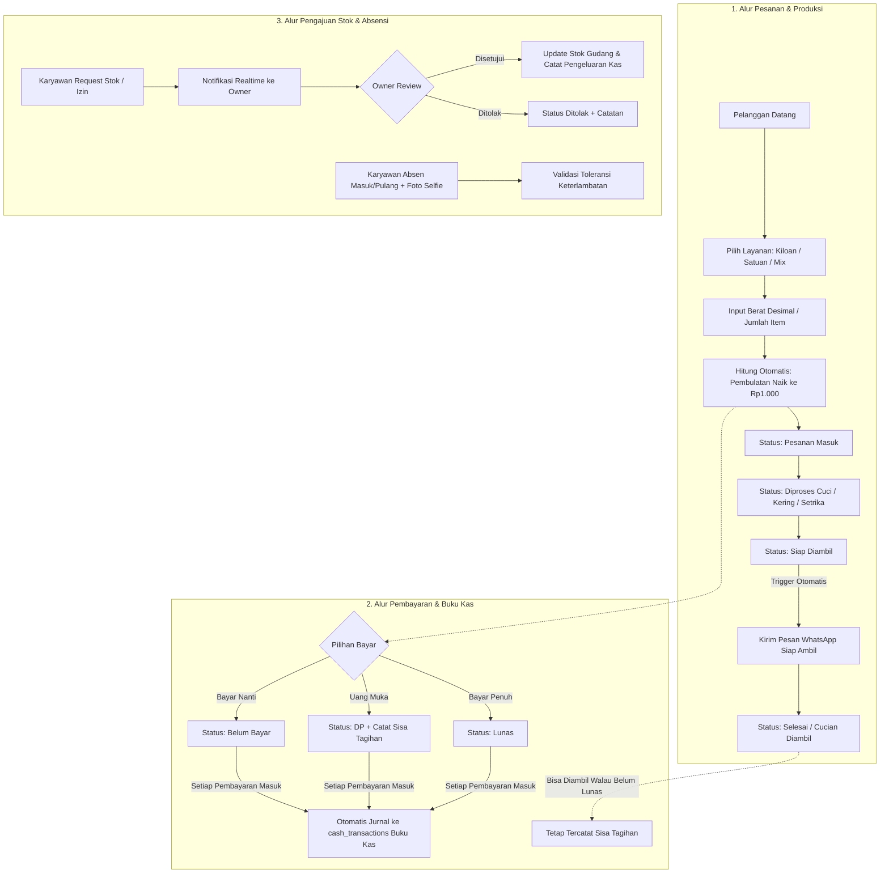

# BLUEPRINT & MASTER FLOW — IDOLA ONE (LAUNDRY APP)

> **Versi Acuan:** Idola One `2.1.15+31` (Update Terkini: 30 Oktober 2026)  
> **Platform:** Flutter Android (Kasir & Karyawan) + React Vite Web (Dashboard Owner) + Supabase Cloud  
> **Status:** Produksi Aktif, Multi-Usaha (Laundry Utama + POS Minuman)

---

## 1. PETA PERAN & HAK AKSES (ROLE MATRIX)

* **Owner (Pemilik Toko)**:
  * Akses penuh ke seluruh unit usaha (Laundry & POS Minuman).
  * Menetapkan harga katalog, mengelola data karyawan, dan mengatur hak akses akun.
  * **Pusat Pengajuan (*Approval Center*)**: Menyetujui/menolak pengajuan stok, izin shift, lembur, dan pencairan kasbon.
  * **Koreksi Transaksi**: Memiliki hak eksklusif mengedit data pembayaran (nominal, metode, tanggal) dengan rekam jejak audit otomatis.
  * **Proyek Besar (B2B)**: Mengatur target *pieces*, tarif khusus, dan termin pembayaran laundry borongan.
  * Akses Buku Kas lengkap, laporan operasional, dan ekspor data CSV.

* **Karyawan Laundry**:
  * Input pesanan (Kiloan, Satuan, Campuran) dan input data pelanggan.
  * Update status operasional: Pesanan Masuk &rarr; Diproses (Cuci/Kering/Setrika) &rarr; Siap Diambil &rarr; Selesai.
  * Menerima pembayaran (Tunai, Transfer, QRIS, DP, Lunas).
  * Cetak nota, label cucian, dan tanda bukti ke printer thermal Bluetooth.
  * Absensi selfie harian (datang/pulang) dan opsi "Lupa Absen" dengan alasan.
  * Mengajukan kebutuhan stok toko dan izin kerja langsung ke Owner.

* **Karyawan Minuman (POS Booth / Es Teh)**:
  * Antarmuka ringkas tanpa menu laundry.
  * Buka/tutup sesi jualan harian, kasir cepat, dan ringkasan omzet hari ini.

---

## 2. BLUEPRINT SELURUH ALUR KERJA (CORE FLOWS)

### Flow 1: Pesanan & Produksi Laundry
* **Input Pesanan Fleksibel**:
  * **Kiloan**: Mendukung berat desimal per 0,1 kg. Minimal 3 kg (ada *override* khusus untuk pelanggan setia).
  * **Satuan**: Terkelompok per kategori (baju, jas, bed cover, sepatu, tas, helm, karpet). Sprei dipisah berdasar ukuran (160, 180, 200).
  * **Campuran (Mix)**: Satu nota bisa menggabungkan kiloan dan satuan.
* **Aturan Pembulatan Harga**:
  * Total akhir tagihan selalu dibulatkan ke atas ke kelipatan Rp1.000 terdekat.
* **Pemberitahuan WhatsApp Otomatis**:
  * Saat karyawan mengubah status pesanan menjadi **Siap Diambil**, sistem langsung membuka WhatsApp dengan template pesan rapi berisi nama pelanggan, nomor nota, dan sisa tagihan.
* **Serah Terima Fleksibel**:
  * Pesanan dapat diambil (status berubah menjadi **Selesai**) meskipun pelanggan belum melunasi sisa tagihan. Piutang tetap dicatat dalam sistem.

### Flow 2: Pembayaran & Nol Kebocoran Kas (Zero Leakage)
* **Metode Bayar**: Tunai, Transfer Bank, QRIS, atau Hybrid.
* **Status Bayar**: Belum Bayar, DP (Uang Muka), Lunas, atau Nominal Bebas.
* **Otomasi Buku Kas**:
  * Setiap kali ada pembayaran masuk (DP maupun pelunasan), sistem database secara otomatis mencatat mutasi pemasukan ke tabel `cash_transactions`.
  * Karyawan dilarang mengubah histori transaksi kas secara sepihak.
* **Koreksi Pembayaran**:
  * Jika ada salah input nominal/metode/tanggal, hanya Owner yang dapat mengoreksi melalui Web/Mobile.
  * Koreksi secara otomatis memperbarui tagihan pesanan, buku kas, dan catatan audit (*audit trail*).

### Flow 3: Cetak Struk Thermal Bluetooth (ESC/POS)
* **Dukungan Printer**: Printer thermal Bluetooth standar (58 mm dan 80 mm, misal seri RPP02N).
* **Pencetakan Terpisah (Modular)**:
  1. **Nota Pelanggan**: Berisi rincian item, subtotal, pembulatan, status pembayaran, dan footer toko.
  2. **Label Cucian**: Ukuran ringkas untuk ditempel pada bungkus plastik cucian.
  3. **Bukti Pengambilan**: Tanda serah terima fisik.

### Flow 4: Pengelolaan Stok & Biaya Operasional
* **Live Stock Monitoring**: Memantau stok Gas LPG 3kg, Plastik (ukuran 30, 35, 40, 45, 50, 55, jinjing, dan satuan), Sabun Deterjen, serta Pewangi.
* **Alur Permohonan Barang**:
  1. Karyawan mengajukan permintaan stok via aplikasi Android.
  2. Permintaan masuk ke notifikasi & Pusat Pengajuan Owner.
  3. Saat disetujui Owner, sistem otomatis menambahkan stok masuk dan mencatatkan biaya pembelian ke Buku Kas.

### Flow 5: Absensi, Jadwal, dan Insentif Karyawan
* **Presensi Mandiri**: Masuk dan pulang wajib menyertakan foto selfie kamera.
* **Keterlambatan**: Jam masuk diverifikasi otomatis terhadap jadwal shift mingguan yang diatur Owner.
* **Fitur Lupa Absen**: Karyawan dapat mengirim tiket "Lupa Absen" dengan menyertakan alasan untuk disetujui Owner.
* **Insentif Khusus**: Insentif tambahan per item (sepatu, helm, tas) yang diverifikasi Owner sebelum masuk ke slip gaji.

### Flow 6: Proyek Laundry Skala Besar (B2B)
* Khusus pesanan borongan (hotel, asrama, instansi):
  * Penetapan target *total pieces* dan tarif borongan (per kg atau per pcs).
  * Input pengerjaan bertahap per batch harian.
  * Termin pembayaran bertahap yang terhubung langsung ke Buku Kas.

### Flow 7: Pembaruan Aplikasi Mandiri (Cloud OTA Update)
* Karyawan tidak perlu instal ulang / uninstall APK secara manual.
* Script rilis `scripts/publish-android.ps1` mengompilasi APK split ABI (`arm64-v8a`, `armeabi-v7a`, `x86_64`) dan mengunggahnya ke Supabase Storage.
* Saat aplikasi Android dibuka, sistem mengecek manifest versi. Jika ada versi baru, notifikasi pembaruan muncul dan APK langsung diunduh serta dipasang otomatis.

### Flow 8: Sinkronisasi Data & Ketahanan Jaringan
* **Realtime**: Memanfaatkan WebSocket Supabase Realtime agar perubahan status pesanan langsung terlihat di layar Owner dan Karyawan.
* **Fallback Polling**: Jika koneksi internet sempat drop, background timer melakukan sinkronisasi ulang berkala setiap 15 detik.
* **Pemuatan Skala Besar**: Data dimuat bertahap (*chunked* 500 baris) agar perangkat tidak lambat saat menangani ribuan pesanan.

---

## 3. RINGKASAN DATABASE & MODEL DATA

| Kategori | Tabel Inti | Fungsi Tegas |
| :--- | :--- | :--- |
| **Tenant & Identitas** | `shops`, `businesses`, `profiles`, `employees`, `business_members` | Isolasi data multi-toko dan multi-usaha dengan hak akses berbasis RLS. |
| **Pesanan & Layanan** | `orders`, `order_items`, `services`, `order_status_history` | Transaksi cucian, snapshot harga saat pesanan dibuat, dan riwayat status. |
| **Keuangan & Kas** | `payments`, `cash_transactions`, `expenses` | Catatan pembayaran pesanan, pengeluaran toko, dan buku kas harian. |
| **Pelanggan & Poin** | `customers`, `customer_point_balances`, `customer_point_events` | Database kontak pelanggan, sinkronisasi Google Contacts, dan poin loyalitas. |
| **Inventaris** | `inventory_items`, `inventory_movements`, `inventory_purchases` | Saldo stok fisik dan pencatatan riwayat keluar-masuk barang. |
| **SDM & Operasional** | `attendance_records`, `weekly_shifts`, `employee_requests`, `payroll_payments` | Absensi selfie, jadwal kerja, pengajuan izin/stok, dan penggajian. |
| **Proyek & Insentif** | `laundry_projects`, `laundry_project_batches`, `item_incentive_rates`, `employee_item_incentives` | Kontrak laundry borongan B2B dan pembagian insentif sepatu/tas/helm. |
| **POS Minuman** | `pos_products`, `pos_sales`, `pos_sale_items`, `business_daily_operations` | Katalog produk, transaksi penjualan, dan sesi buka kasir harian booth minuman. |

---

## 4. CHECKLIST STANDARD OPERATING PROCEDURE (SOP)

* **Buka Toko**:
  1. Karyawan melakukan absensi masuk dengan foto selfie.
  2. Buka aplikasi, pastikan printer thermal Bluetooth terhubung (status *connected*).
  3. Cek sisa stok plastik dan sabun di menu Live Stock.
* **Menerima Cucian Masuk**:
  1. Pilih pelanggan (atau tambah baru dengan nomor WhatsApp aktif).
  2. Timbang dan pilih jenis layanan (Kiloan / Satuan).
  3. Terima pembayaran (jika DP/Lunas, input metode bayar).
  4. Cetak nota pelanggan dan tempel label pada kemasan cucian.
* **Proses Cucian Selesai**:
  1. Ubah status pesanan menjadi **Siap Diambil**.
  2. Kirim pesan WhatsApp otomatis yang muncul di layar.
* **Pengambilan Cucian**:
  1. Konfirmasi pelunasan sisa tagihan jika sebelumnya masih DP/Belum Bayar.
  2. Ubah status menjadi **Selesai**.
* **Tutup Toko**:
  1. Karyawan melakukan absensi pulang dengan foto selfie.
  2. Owner memverifikasi ringkasan Buku Kas harian vs uang fisik di kasir.
